# ChungusDiet

ChungusDiet is a React Native calorie and nutrition tracking app built with Expo. It combines a daily food diary, meal discovery, nutrition targets, and weight reports with account-based profile setup.

## Overview

The app helps users record meals and water intake, review nutrition totals, discover recipes, and track weight over time. User accounts and profile data are backed by Firebase Authentication and Cloud Firestore.

## Features

- Onboarding, email sign-up and sign-in, and password reset
- Guided profile setup with personal details, activity level, goals, and recommended calorie targets
- Daily diary with date selection, meal entry and editing, nutrient totals, and water intake
- Recipe discovery using TheMealDB random and name search endpoints, with recipe detail views
- Weight reports with dated entries and a trend chart
- Profile and settings screens for profile details, calorie and water targets, profile image selection, password changes, and sign-out
- Light and dark theme support

## Technology

- React Native 0.88.1 and React 19.3.0
- Expo SDK 58
- React Navigation 7
- Firebase Authentication and Cloud Firestore
- AsyncStorage for React Native authentication persistence
- React Native SVG and chart libraries
- TheMealDB public API for recipe data

## Requirements

- Node.js and npm
- Expo Go for SDK 58 on an Android device or a compatible emulator
- A Firebase project with Email/Password Authentication and Cloud Firestore enabled

## Setup

1. Clone the repository and install dependencies:

   ```sh
   npm ci
   ```

2. Create a `.env` file in the project root and provide the Firebase web app configuration:

   ```dotenv
   EXPO_PUBLIC_FIREBASE_API_KEY=your_api_key
   EXPO_PUBLIC_FIREBASE_AUTH_DOMAIN=your_project.firebaseapp.com
   EXPO_PUBLIC_FIREBASE_PROJECT_ID=your_project_id
   EXPO_PUBLIC_FIREBASE_STORAGE_BUCKET=your_project.appspot.com
   EXPO_PUBLIC_FIREBASE_MESSAGING_SENDER_ID=your_sender_id
   EXPO_PUBLIC_FIREBASE_APP_ID=your_app_id
   ```

   These are Expo public environment variables and are bundled into the client app. Do not put private service account credentials in the app. Configure Firebase security rules for the data your project stores.

3. Start the development server:

   ```sh
   npx expo start
   ```

   Connect your Android phone to the same Wi-Fi network as your computer, then scan the QR code in Expo Go.

## Usage

Create an account or sign in, complete the profile setup, then use the bottom navigation to open Recipes, Diary, and Reports. The profile area provides account settings and configurable calorie and water targets.

Recipe search requires an internet connection and uses TheMealDB. Account and diary features require valid Firebase configuration and an enabled Firebase Authentication and Firestore setup.

## Screenshots

### Light theme

| Diary | Weight reports | Recipes |
| --- | --- | --- |
| 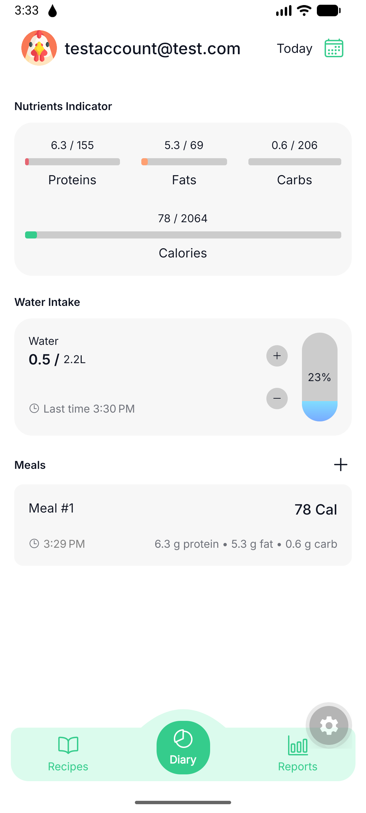 | 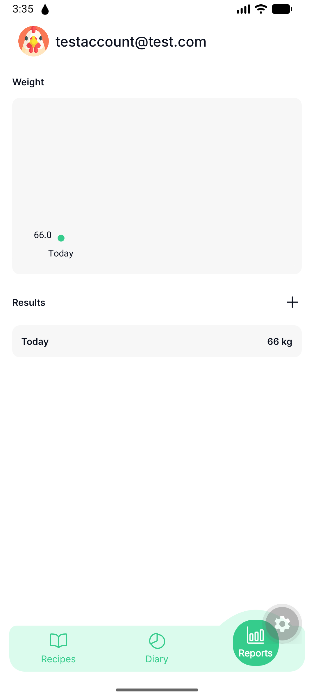 | 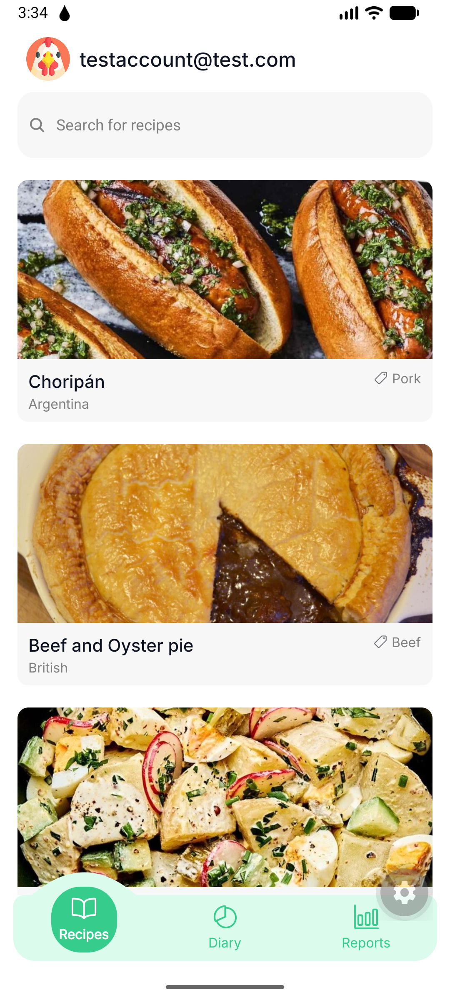 |

| Recipe details | Profile |
| --- | --- |
| 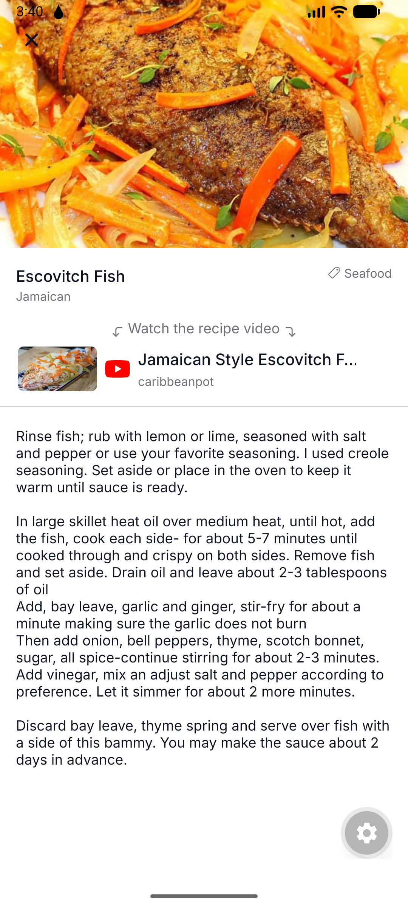 | 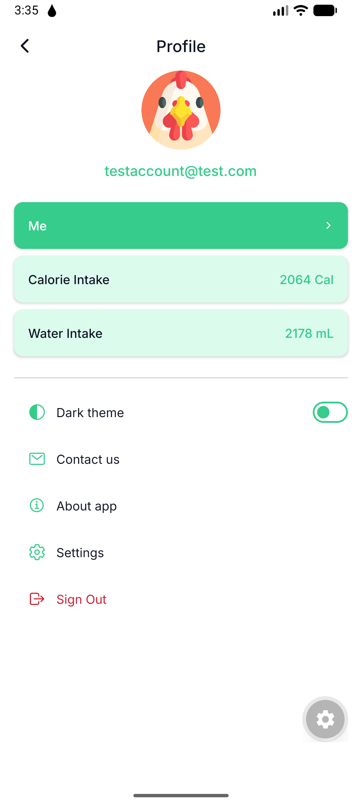 |

### Dark theme

| Diary | Weight reports | Recipes |
| --- | --- | --- |
| 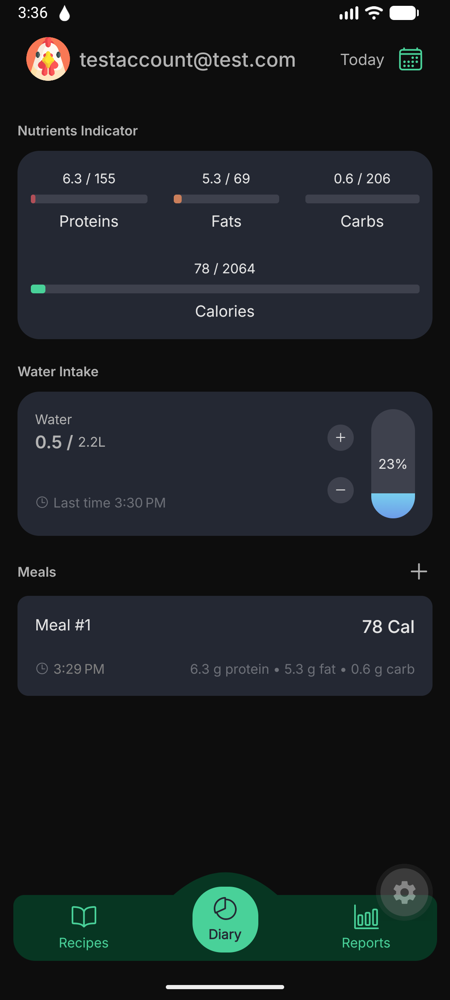 | 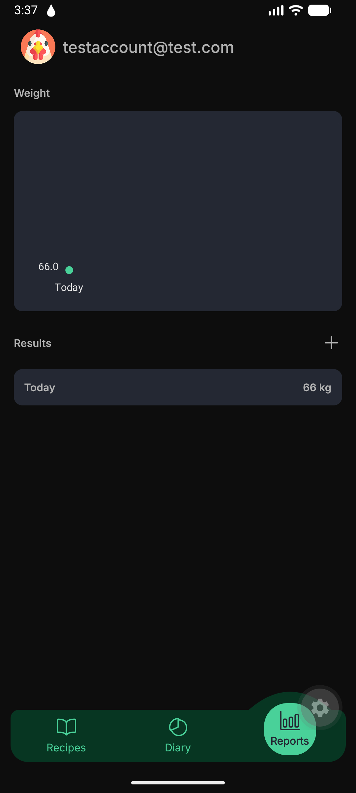 | 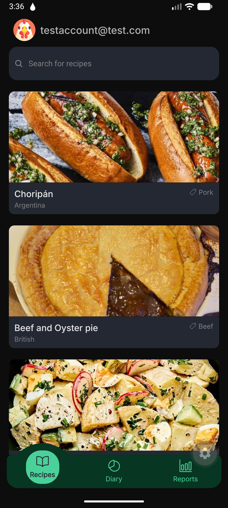 |

| Recipe details | Profile |
| --- | --- |
| 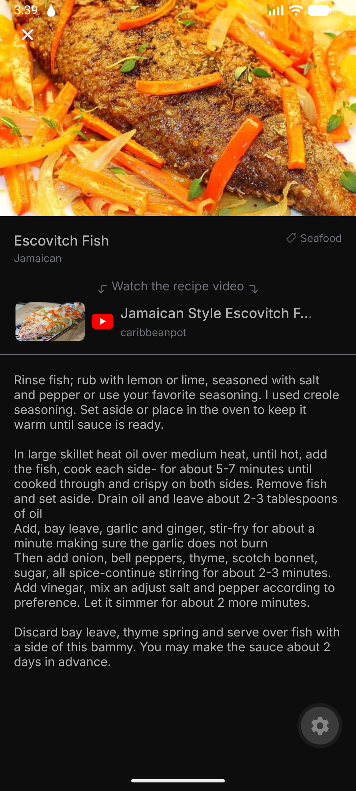 | 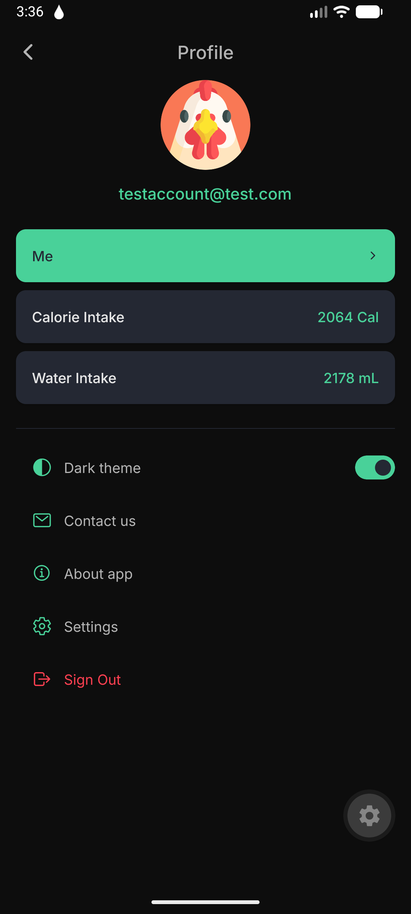 |

### Welcome and profile setup

| Welcome | Setup step 1 | Setup step 2 |
| --- | --- | --- |
| 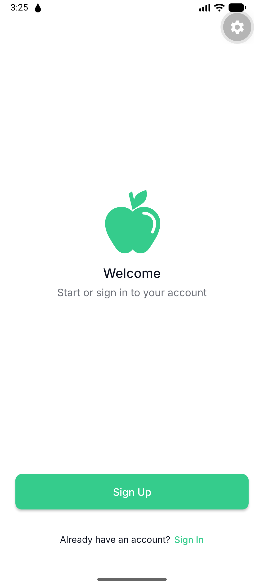 | 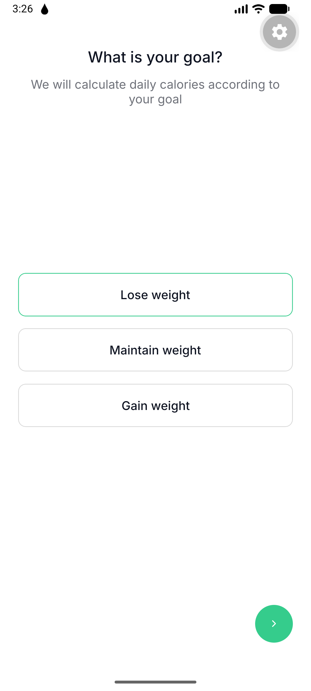 | 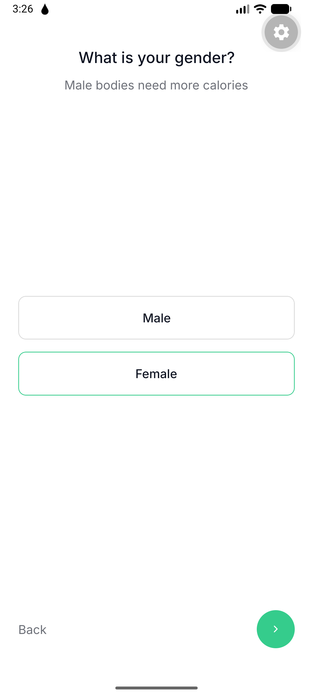 |

| Setup step 3 | Setup step 4 | Setup step 5 |
| --- | --- | --- |
| 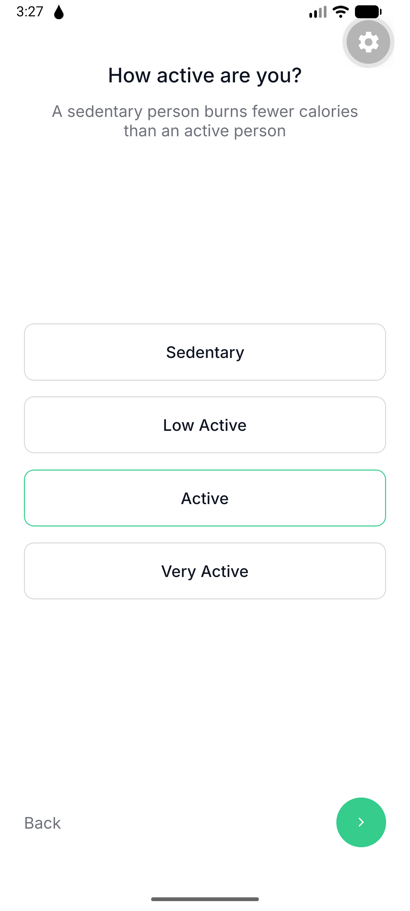 | 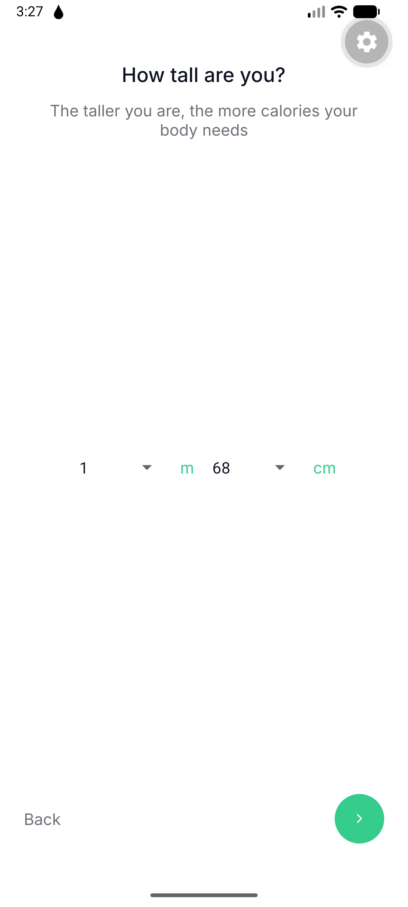 | 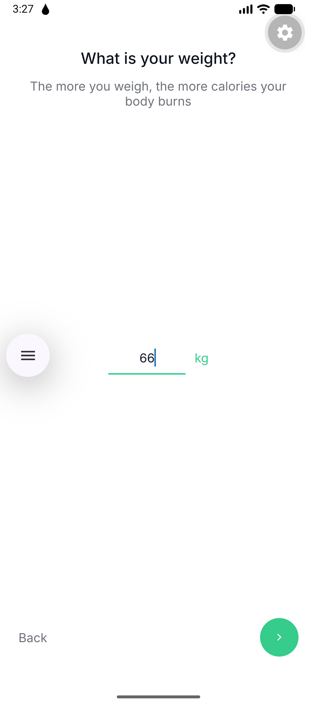 |

| Setup step 6 | Setup step 7 | Setup summary |
| --- | --- | --- |
| 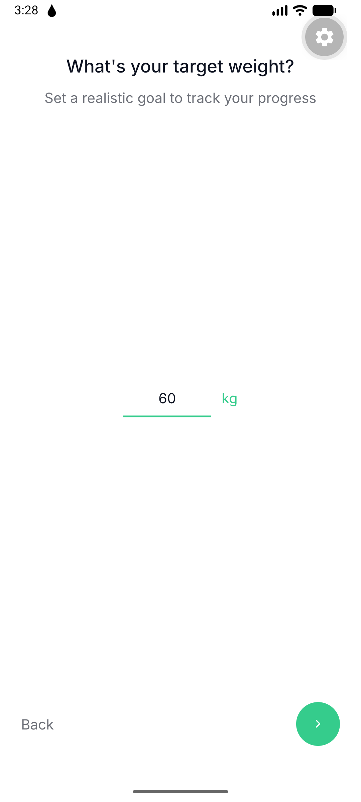 | 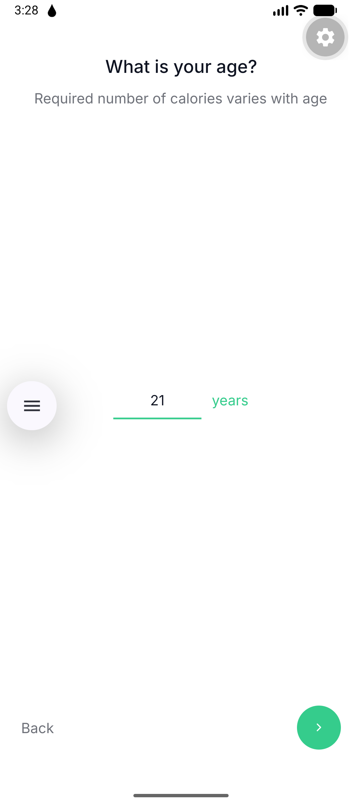 | 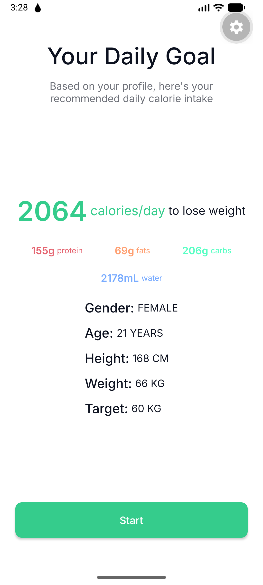 |

## Project structure

```text
App.js                 Navigation and authentication state
screens/               Onboarding, auth, profile setup, and app screens
components/             Reusable UI components
config/                 Firebase client configuration
context/                Theme context
services/               User profile data access
data/                   Onboarding content
constants/              Shared design constants
assets/                 Fonts and image/vector assets
```

## Status

This is a student project. Firebase configuration and backend security rules must be supplied by each developer. Recipes depend on TheMealDB being reachable. The repository does not currently define lint or test scripts.
